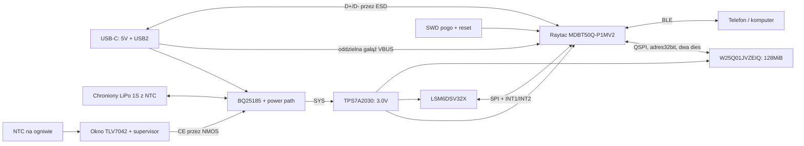

# Architektura i założenia A1

Stan: **A1 FINAL REVIEW / CONDITIONAL READY**, 2026-10-29. Istnieje edytowalny projekt KiCad 10.0.7: schemat z 72 symbolami, PCB z 69 footprintami i routingiem, natywne raporty oraz eksport PDF/STEP. Nie wykonano prototypu ani firmware. Routing jest kompletny; przegląd elektryczny/produkcyjny i kwalifikacja pozostają otwarte.

[Raport walidacji](../reports/validation_status.json) wskazuje wejścia i hashe. Końcowy [natywny DRC](../reports/drc_final.json) ma 0 naruszeń, 0 brakujących połączeń i 0 rozbieżności schemat–PCB po ponownym wypełnieniu stref. ERC ma 0 błędów i 2 świadome ostrzeżenia U4.2/3. To nie zamyka osobnej [listy kontroli](release_checklist.md) przed zamówieniem prototypów. Wcześniejsze raporty DRC zachowano jako historię.

Moduły obu nóg są identyczne i pracują niezależnie. UID oraz jawna konfiguracja lewej/prawej nogi są metadanymi. PCB nie wymusza ODR, zakresów ani filtrów: dobiera je firmware. Nie ma magnetometru ani GPS. BLE służy sterowaniu, kotwicom synchronizacji i pobieraniu; rejestracja nie wymaga stałego połączenia.

## Zasilanie

Jedna regulowana szyna ma 3.0 V. VDD i VDDH modułu są razem w normal voltage mode; USB VBUS trafia osobno na dedykowany pin. SYS ładowarki może mieć około 4.5 V i nie zasila GPIO/Flash. TPS7A2030PDBVR ma znamionowo 300 mA; pełny budżet prądu i cieplny trzeba sprawdzić dla pamięci 128 MiB i trybów BLE. Przy przykładowym obciążeniu 100 mA strata LDO z SYS=4.5 V wynosi 0.15 W — to obliczenie, nie zmierzony pik.

BQ25185 ma ustawiony nominalny limit wejścia 100 mA i prąd ładowania 150 mA, ograniczany dostępnym prądem po zasileniu systemu. Preferowany pakiet ma 300 mAh. Dla 500 mAh nie potwierdzono pełnego cyklu w timerze 360 min typowo. CE restartuje timer, dlatego firmware nie może cyklicznie go zerować. R24=100k jest pull-up do 3V0: HIGH/HiZ/reset blokuje ładowanie, LOW zwalnia sprzętowe okno temperatury; przy niesprawnym MCU ładowanie pozostaje zablokowane. Nie ma detekcji prądu źródła ani przełączania na szybsze ładowanie. C1/C3 mają 2.2 µF/25 V; minimalne pojemności efektywne i termika pozostają do kwalifikacji.

Limit BQ obejmuje jego IN, a nie cały pobór z portu. Osobna gałąź USB VBUS do modułu omija BQ; nRF52840 ma z niej regulator interfejsu USB. Wymagane są budżet i pomiar całego portu podczas rozruchu, transferu i suspend. CHG_INHIBIT wyłącza ładowanie, ale nie odłącza SYS ani VBUS modułu. [Nordic: POWER, USB supply](https://docs.nordicsemi.com/r/bundle/ps_nrf52840/page/power.html), [TI BQ25185](https://www.ti.com/lit/ds/symlink/bq25185.pdf). Szczegóły są w `firmware_contract.md`; zgodności USB nie potwierdzono.

EN LDO jest stale włączone. „Wyłączenie” przyciskiem to nRF System OFF, nie mechaniczne odłączenie baterii. Flash przechodzi w deep power-down, IMU w power-down; standby trzeba zmierzyć. Dzielnik VBAT 1M/1M pobiera około 2.1 µA przy 4.2 V. Blok NTC dodaje około **138 µA** w battery-only: BQ nie polaryzuje wtedy TS, a komparator HOT ściąga pullup 100k. To jawny koszt obecnej topologii; nie potwierdzono niskiego poboru całego urządzenia.

Zapis należy kończyć z zapasem przed dropout i spadkiem 3V poniżej minimum Flash. Docelowy próg VBAT ustalić po pomiarach pod obciążeniem, wstępnie około 3.3 V. Odcięcie PCM następuje zbyt późno do uporządkowanego zamknięcia zapisu. Nie zakładać, że kondensatory pozwolą opróżnić cały RAM po odłączeniu.

## Pojemność

Budżet: 16 B na parę accel+gyro z uśrednionym narzutem, 95% pamięci dostępne na sesje. To założenie projektowe, nie finalny format.

| Pamięć na moduł | 480 Hz | 960 Hz | 1920 Hz |
|---|---:|---:|---:|
|64 MiB, wariant pierwotny|138 min|69 min|35 min|
|**128 MiB, aktualna A1**|277 min|138 min|69 min|
|256 MiB, ewentualny dalszy dobór|553 min|277 min|138 min|

Samo 14 B tagowanego FIFO przy 128 MiB i 1920 Hz daje 83.2 min przed rezerwą i innymi rekordami. Nie sumować pojemności obu nóg jako czasu jednego modułu. W25Q01JVZEIQ ma korpus 8×6 mm i dwa dies; samo adresowanie 32-bitowe nie zastępuje sprawdzonej obsługi obu matryc. Wariant 256 MiB wymaga osobnego doboru części i footprintu.

## Aktualne PCB i mechanika

Obrys wynosi **30×51.6 mm** w osiach X/Y i zastępuje wstępny cel 50×28 mm. Warstwy: TOP sygnały/elementy, In1 ciągła GND, In2 mieszana +3V0/sygnały, BOTTOM sygnały oraz SWD i pola testowe. Robocza grubość to **1.0 mm**. Stos i geometria USB muszą pochodzić z konkretnej oferty JLCPCB; obecne ścieżki nie dowodzą 90 Ω. Nie zakłada się microvia/blind via. Roboczy CPL ma 59 pozycji montażowych przy 69 footprintach.

Antena jest przy końcu płytki. Keepout przedłużono do krawędzi na wszystkich warstwach; sprawdzone wypełnienia mają 0 mm² miedzi w zakazanej strefie. Kontrolę powtórzono po ostatnim routingu/refill; niezależny przegląd Gerberów pozostaje otwarty. Bateria i metal obudowy także muszą być poza anteną. USB i przycisk są na drugim końcu, ponad 10 mm od sensora według przeglądu geometrii. Podparcie płytki, pakiet i naprężenia po zamknięciu obudowy wymagają sprawdzenia; nie zaprojektowano elastycznej wyspy IMU bez analizy rezonansów. Orientację osi oznaczyć i zapisać w metadanych.

QSPI używa szybkich pinów P0 i rezystora źródłowego 22 Ω do strojenia. Całe trasy i droga powrotna wymagają finalnego przeglądu. Lokalne połączenia pin–kondensator zasilania mają około 1.3–1.6 mm; przelotki termiczne BQ leżą poza EP. Geometria wyjść IMU, miedź pod nim, maska i pasta LGA/WSON podlegają końcowemu DFM. DRC nie potwierdza szumu IMU, sygnałów ani temperatury w obudowie.

Roboczy STEP jest natywnym eksportem KiCad. **Brakuje modelu USB-C**, Raytac jest modelem ogólnym rodziny, Flash ma jawny gabaryt maksymalny 8.10×6.10×0.80 mm. Model IMU ma 0.80 mm wobec maksimum ST 0.86 mm. Do obudowy potrzebne są właściwe rysunki, tolerancje i rzeczywiste części; [przegląd mechaniczny](mechanical_model_review.md). Pakiet, przewody i obudowa nie należą obecnie do zespołu.

## Przekazanie do PCBA

Gerber/Drill/CPL wyeksportowano natywnie z połączonego PCB po 0 błędów DRC i 0 opens, ze wspólnym aux origin **(50,101.6) mm**. Pliki i manifest są w `manufacturing/review/`. Trzeba jeszcze sprawdzić CAM i rotacje/przesunięcia elementów w JLCPCB. Pliki mają status REVIEW; nie zwalniają projektu do zamówienia.

Dla JLCPCB Standard przewidzieć szyny panelu **co najmniej 5 mm** z fiducjalami: zalecane 3–4 znaczniki, Cu 1 mm, otwarcie maski 2 mm i odstęp od krawędzi według [wytycznych JLCPCB](https://jlcpcb.com/help/article/how-to-add-edge-rails-fiducials-for-pcb-assembly-order). Nie dodano teraz fiducjali do ciasnego modułu. Geometrię szyn/mostków uzgodnić w DFM tak, żeby panel i jego metal nie naruszały obszaru anteny; potwierdzić sposób oddzielania bez obciążania IMU. Zaopatrzenie exact MPN, ochrona pakietu i NTC na ogniwie pozostają osobnymi warunkami.

## Ustalenia audytu 29.10.2026

[Raport A1](audit_A1_2026-10-29.md) jest punktem wejścia do oceny zmian. INT1=P0.11 i INT2=P0.12 są ostateczną pinmapą. [Flash](flash_compatibility_A1.md) wymaga jawnej polityki dwóch dies, QE stałego 1 dla IQ i kwalifikacji resetu/DPD. Wszystkie klasy ERC/DRC są aktywne. Via U5.7 odsunięto do (71.85,73.76); U6/R25 przesunięto lokalnie, zachowując główny routing. Minimum otwór–Cu/pasta wynosi nominalnie 0.150 mm. Żaden z tych wyników CAD nie jest testem sprzętu.

## Końcowa wersja prototypów

Obowiązuje [raport końcowy](final_verification_A1.md) i manifest bieżących plików. Wybrano JLC7628 4L1.0mm do potwierdzenia w zamówieniu;18 szerokości USB In2 zmieniono na0.17mm przy0.13mmgap, bez zmiany przebiegu. R24 oraz power-path pozostają. Doprecyzowano hangLOW/SystemOFF w firmware. Testy fizyczne są klasąB; warunki zamówienia A01–A04 są osobne.
